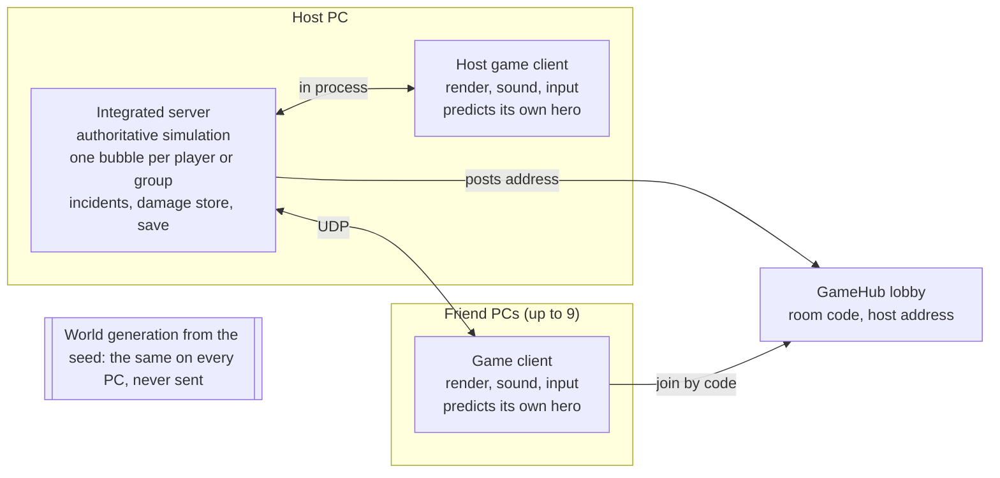

# HeroWorld design

As of 2026-11-08. The living copy is the [HeroWorld design](https://claude.ai/artifact/ErRuq4DwAK66B4BRJcZojv) doc; this file is a snapshot of it.

## Vision

HeroWorld is a superhero sandbox on a whole procedurally generated planet. You play alone or with up to 10 friends, and almost everything can be broken. It's written in Rust on Engine and replaces Scale, the earlier single-player TypeScript attempt.

- **Look and feel:** old-school SF from when comics were young. Giant robots, flying cars, art deco and raygun gothic towers, aliens and mole people. Fun but recognizable, with real heroes and villains.
- **Tone:** a positive, beautiful utopia by default, with a bottom layer of villains as in old comics and plenty of dystopian regions.
- **Rendering:** detailed, physically based lighting that makes the utopia shine, not a toon or ink style.
- **Players:** single player is the main case. One player's PC hosts friends (at most 10, usually far fewer), and players can split up anywhere on the planet.
- **Heroes only:** no player villains and no PvP.

## The world

The world is a roughly Earth-sized procgen planet, not Earth: its own continents, several moons in the sky, and everything derived from the seed.

- **Generation in layers, lazily:** planet (continents, mountains, climate, biomes, rivers) → regions (nations, thousands of city sites, roads and rail between them) → local detail in the style of Scale's city plans, only where a player is. Every layer comes from path-keyed hashing of the seed, so any piece can be rebuilt anywhere and comes out the same.
- **Coordinates:** 64-bit positions measured from the planet's centre, with a floating origin per player. No flat "Y is up everywhere" assumption, so space can come later.
- **Zones with level ranges:** utopian cores (accidents, rescues, petty crime) are low level, edge zones (gangs) are in the middle, and dystopian regions (villain rule, robot armies) are high. The procgen places the levels.
- **Liberation is temporary:** a freed dystopian region drops to a lower level band for a while, then slips back.
- **The world does not evolve on its own (v1).** It changes through incidents, through damage and through what players do.
- **Self-repair:** damaged areas repair themselves off camera, when no player has seen them for a while. Saves only hold areas that are damaged at the moment, plus player progress.
- **Most of the planet is wild:** problems gather in cities, and the wild land is for scenery and travel, not filler content.
- **Travel:** the higher you fly, the faster you can go. Low over a city, speed is limited by what we can stream; high up, the ground is coarse LOD and Mach 20 is fine. Fast travel fits the era: rocket rails, pneumatic tubes, teleport booths.

### Interiors

Every building has an interior, and interiors are a first-class part of building generation from day one. Scale added them after the fact and its interior designer never got good.

- **Inside-out generation:** a building's plan starts with its floors and rooms. The facade comes from the rooms (windows where rooms have them, doors where entrances are), so outside and inside always match.
- **More spacious than real life:** higher ceilings, wide corridors and doors, so a third-person camera and a flying hero can move through them easily.
- **Same retro-utopian theme** as the outside: furniture and fittings from AssetGenerator prop specs.
- **One continuous world:** breaking a wall shows the real room behind it. Interiors stream in by distance like the rest of the building, not as separate spaces behind portals.

### Underground

The underground is a living layer of its own. Sewers are only one part of it, and there is no metro.

- Sewers and utility tunnels under the streets
- Pneumatic tube lines (fast travel) with stations
- Mole people caverns and settlements
- Villain lairs and hidden labs, especially under the dystopias
- Forgotten older layers: ruins and vaults below the modern city

### Traffic

There is no metro. Ground traffic runs on the streets, and flying taxis fill the sky in lanes at set heights, with stands on roofs and platforms. The player can hail one. Taxi rescues are left out for now.

### The first city's look

The utopia is a 1939 World's Fair that became a real city: art deco and streamline moderne towers, googie roofs, chrome and glass, gardens everywhere. The dystopia is the same city with its light stolen.

**The utopia**

- **Materials and colour:** cream and white stone, brushed chrome and brass trim, glass domes, terrazzo plazas. Accents in teal, coral and sunflower yellow. Warm, saturated sunlight.
- **Shapes:** stepped towers with setbacks and spires, rounded corners and horizontal speed lines, sky bridges between towers, landing decks for flying taxis, rooftop gardens and pools.
- **Streets:** wide boulevards with trees and planted medians, fountains, hero statues, kiosks. Streets and interiors are roomier than real life.
- **Night:** neon tubes, searchlights sweeping the clouds, lit towers. Glowing Aether conduits run along buildings like veins of light.

**The dystopia (the mad scientist's district)**

- The same architecture, robbed of Aether: dead conduits, broken neon, boarded and blown-out windows, soot, smog that sits low in the streets.
- His own buildings rise out of it: Tesla towers arcing green, a lab complex behind walls, searchlights and patrolling robots.
- **Colour grading per zone** makes it read instantly: warm and saturated in the utopia, desaturated green-grey with thick fog in the dystopia, with a transition band at the edges (graffiti, flickering lights, barricades).

**Districts of the first city**

| District | Character | Landmark |
| --- | --- | --- |
| Civic centre | plazas, the tallest towers | Hero Hall (home of the NPC heroes) and the Aether Spire, visible from anywhere |
| Commercial | shops, cafés, cinemas with marquees | a grand department store |
| Residential | garden towers, streamline apartments, googie bungalows | a park with a lake |
| Aether Works | the power plant, conduits, workshops | the glowing reactor dome |
| Expo grounds | fair pavilions, a rocket on display | the rocket |
| Waterfront | promenade, piers, seaplanes | a lighthouse |
| The dystopian district | the corrupted quarter | the Doctor's Tesla tower |

Landmarks are placed so that a hero can always orient by the Aether Spire and the Doctor's tower.

### Destruction

Buildings break element by element as in Scale, what breaks depends on how strong the hit is, and repair happens only where no one is looking.

- **Elements:** every building is made of wall panels (one per window bay per floor), slabs, columns, roof pieces, and inside, partition walls, doors and furniture. A broken element is one bit in the building's state.
- **Materials set strength:** glass, then wood and plaster, brick, concrete, and reinforced steel. A hit breaks what its force exceeds, so low-level heroes break glass, props and cars, and only high levels can bring down a tower. No separate unlocks.
- **Structure:** each damaged building is checked floor by floor (Scale's rules). Even loss of support pancakes the floors above; one-sided loss topples the upper part around a hinge. At most one or two collapses run at once per bubble.
- **What the server decides vs what clients draw:** the server owns the element bits, collapses and the rubble mounds (simple shapes made from the collapse, the same on every machine). Flying debris, dust and sparks are cosmetic on each client, from a fixed pool that freezes into static rubble.
- **Vehicles:** dents, broken glass, wrecks. Aether cars don't explode; they spark, fizz and die, which suits the tone. Props (lamps, benches, trees, kiosks) bend, topple and break.
- **People:** knocked down as ragdolls, never killed. Injured civilians become small rescue tasks (carry to a medic) and count as collateral.
- **Collateral:** each incident tallies damage and injuries caused by heroes. Above a threshold it costs a little karma and trust; below it, a small careful-hero bonus.
- **Off-camera repair:** a damaged area repairs once no player has seen it for about 10 minutes and none is within about 300 m. It snaps back whole, and the save drops that area's damage. Nobody ever sees the repair happen.
- **Ground:** scorch marks, cracks and road decals for now. Digging and craters get their own discussion later.

## Heroes

Heroes progress through 20 levels in about 10 hours of play, spend karma on powers, and lean towards an affinity that makes matching powers cheaper. City of Heroes is the reference direction, at a smaller scale.

- **Levels:** cap 20 at first, about 10 hours to reach it. Later levels will be slower. Levels balance easily and read well for players.
- **Level syncing for co-op:** like City of Heroes' sidekick and exemplar, a player is raised or lowered to the group's level, so friends at any level can play together.
- **Karma:** earned by deeds, spent on powers, as in Scale.
- **Affinities grow from deeds, not from a menu.** Each deed pushes the hero's leaning, and powers in that leaning cost less.

| Affinity | Deeds that push it |
| --- | --- |
| Guardian | rescues, protecting people |
| Justice | stopping crime and villains |
| Science | robots, tech, disasters |
| Mystic | the strange and supernatural |
| Might | big fights, monsters |

- **Roles:** every power has one role: damage, control, movement, defence or rescue.
- **Powers = mechanic + theme.** The mechanic is the role, the shape (bolt, beam, cone, area, aura, wall, summon), the numbers and the side effect (slow, hold, knockback, damage over time). The theme (ice, fire, energy, stone, shadow, light, sonic, gadget...) decides the visuals, sounds and the mark left on the world. The player picks the theme. Balancing, levels and the network only deal with the mechanic.
- **Themes are cosmetic** for now. One rule: the side effect must read clearly in every theme (a slow looks like frost, a web or mud).
- **Balance against a budget.** Each power gets one budget from its tier and the hero's level, split across damage, area, range, cost and cooldown. Headless tests fight powers against standard targets and flag outliers. Scale balanced by energy cost alone, which didn't work.
- **Collateral damage is a soft cost:** some trust and a little karma. Careful heroes get a small bonus.
- **Looks:** the proof of concept uses what Actors already has. A full costume creator comes later, on the Actors Rust port (in progress).

* **Destruction grows with level.** Low-level heroes break glass, props and cars; mid levels break walls and interiors; high levels can bring down buildings. It follows from strength scaling, not a separate unlock. Digging and craters in the ground need their own design discussion and may come later.
* **Defeat:** like Scale, a drone carries the hero to the nearest hospital. Teammates can revive them before it arrives. No size changing.
* **Camera:** third person like Scale, zooming in to first person.

### Starting out

- **Heroes start as ordinary people** with no powers, or one weak attack. They earn their first karma the normal way: helping the injured to medics, stopping petty thieves, putting out small fires, finding lost people.
- **Early unlocks feel big:** super jump with full air control comes early, and flight is an early, rewarding unlock. Super speed comes later, because it needs auto-navigation to feel good (Scale did some of that work).
- **Starting powers for the slice:** super jump, flight, energy bolt, shockwave, binding hold, force shield, lift and carry.
- **Backstory: the Aether**, a cosmic energy field the utopia runs on. A few people resonate with it, and selfless deeds strengthen that resonance (that's karma). Villains resonate through strong will and steal Aether; dystopias are where it's hoarded or corrupted. Each hero picks a personal origin at creation (lab accident, alien artifact, meteor shard...), which gives a small push towards one affinity.

### Power unlocks

One source, two counters: every deed earns karma. **Lifetime karma sets your level** (your resonance with the Aether); **unspent karma buys powers**. Spending never lowers your level.

- **No power ranks.** Every power grows automatically with your level, so your first power never becomes obsolete. A new power always brings something fresh, never just a bigger number, which also means new powers are not that common.
- **Levels open tiers.** Each power belongs to a tier, and a tier opens at a fixed level.
- **Higher tiers cost more and are more potent.** That's the real choice: many cheaper low-tier powers, or fewer, stronger ones.
- **Each new power costs more than the last** (no hard cap). Proposed price: tier base × (1 + 0.25 × powers owned) × affinity factor, with tier bases rising about 1.5× per tier.
  - **One level of karma buys about one low-tier power.** Karma needed per level grows at the same rate as the per-power price (1 + 0.25 per level), so a hero can take a new tier-1 power every level, or save two or three levels for a higher tier.
- **Affinity discount:** powers in your leading affinity cost up to 30% less, scaled by how strongly you lean. Movement powers belong to no affinity.
- **Strength is computed, not stored:** a power's numbers come from (level, tier). Level syncing in co-op just computes them at the synced level and hides powers above its tier.
- **No respec.** You can give up a power and get back 90% of the karma you paid for it. Choices have consequences.
- **Dollars for equipment:** maybe later, if at all.

| Tier | Opens at level | Slice powers |
| --- | --- | --- |
| 1 | 1 | strike (free, weak), energy bolt, super jump |
| 2 | 3 | binding hold, force shield, lift and carry |
| 3 | 5 | flight, shockwave |
| 4 | 8 | later |
| 5 | 12 | later |
| 6 | 16 | later |
| 7 | 20 | capstones, later |

**Pacing target:** 20 levels in about 10 hours, with early levels fast. Level 2 after about 10 minutes, level 3 after about 25, level 5 (flight) after about an hour.

## Enemies and factions

Factions are goofy early SF, and not all of them are evil, but some are evil enough to be real enemies. Each one lines up with an affinity, so every leaning has its own enemies. The list below is a first proposal.

| Faction | Stance | Fits affinity |
| --- | --- | --- |
| Mole people: grumpy, misunderstood, surface where the ground breaks | neutral | Guardian |
| Venusian traders | friendly | Science |
| Lost-world valley with dinosaurs | neutral | Might |
| Rogue robots who want rights | neutral | Science |
| Iron-masked empire that rules the dystopias | evil | Justice |
| Death-ray mad scientist and his mutants | evil | Science |
| Shadow cult | evil | Mystic |
| Sky pirates | evil | Justice |
| Invaders from one of the moons | evil | Might |

Villains come in tiers: thugs, then lieutenants, then supervillains with lairs in the dystopian regions.

### Standing: who fights whom

Arnd's direction (2026-11-08): this is a world that goes on without the heroes, not an action game where everything attacks the player. A new hero is a nobody.

- **Every faction has a standing toward every other**, from -100 to 100: hostile (-60 or less), unfriendly (-20 or less), neutral, friendly (20 or more) and allied (60 or more). Townsfolk are a faction too.
- **A hero starts with exactly the townsfolk's standings.** Each faction regards a new hero the way it regards any passer-by. The hero's sheet keeps only how their deeds have moved that (per hero, saved with the hero).
- **Behaviour follows standing.** Hostile attacks on sight. Unfriendly warns a hero off its own turf ("Beat it, cape!") and attacks one who comes within about 9 m or stays 6 s; off its turf it leaves people alone. Neutral and better leave the hero alone.
- **Provoked, any group fights back:** hit one of them and the whole group turns on you. A crime's crooks turn on a hero who steps in (comes within the crime's reach: 9 m for a mugging, 12 m for a robbery, 16 m for a rampage).
- **Deeds move standing:** each of a faction's people beaten lowers its regard by 2 and raises by 1 every faction that dislikes it (townsfolk and the Patrol included). About fifteen Chrome Jackets beaten and the Jackets attack on sight.
- **Co-op:** each hero keeps their own standing; a group reacts to the least liked hero near it.
- **Townsfolk can't be targeted** by heroes (for now).
- **Turf is fixed in 1.0:** borders don't change hands.

| Faction | Who | Turf | Toward a new hero |
| --- | --- | --- | --- |
| Townsfolk | ordinary people | | friendly |
| City Patrol | officers, police drones | | friendly |
| The Doctor's Lab | mutant brutes, ray-gun technicians, robo-sentries, the colossus | the dystopian quarter | unfriendly (warns, then fights) |
| Chrome Jackets | greasers in leather and denim: muggings, street crime | later: the edge band | unfriendly |
| Velvet Syndicate | pinstriped gunsels with ray pistols: robberies, rackets | | neutral |
| Molehaven | the mole people | the underground | neutral |

The world reacts to trouble too: pedestrians back away, run or gawk, and cars brake and queue round a mugging, a fight or a collapse (the crowd and traffic "alarm" system).

Robots need more than Actors offers today (its robots are human skeletons in robot dress). Non-human robots, from tracked tanks to spider walkers to giant mechs, come from AssetGenerator rigs with breakable parts as Engine prefabs, plus procedural gaits.

## Combat

Combat follows City of Heroes: a hero mows through groups of simple enemies, and bosses are the real fights. Tab targeting and ragdolls carry over from Scale.

| Rank | What it is | Feel |
| --- | --- | --- |
| Minion | the crowd, groups of 3 to 8 | falls in one or two hits |
| Lieutenant | a tougher member with a trick (shield, heal, net) | a few seconds each |
| Boss | leads a group, signature attack | a short duel |
| Supervillain | named, with a lair | a fight with phases |
| Colossus | giant robots and monsters | a set piece, best in co-op |

- **Con colours:** the target frame tints each enemy by level against yours (grey, green, blue, white, yellow, orange, red, purple), so difficulty reads at a glance. Grey enemies give no karma.
- **Groups scale with the team:** more players means bigger groups and more lieutenants, not tougher minions.
- **Targeting:** Tab cycles targets nearest the crosshair, as in Scale. Single-target powers need a target; area powers centre on the target or the crosshair.
- **Health and energy:** powers cost energy, and both refill quickly out of combat, so the next fight starts fresh.
- **Ragdolls:** knockback launches enemies as ragdolls, and they get up again (Scale's get-up poses). It's the main source of comic-book slapstick.
- **Nobody dies:** it's a Golden Age utopia. Defeated villains are cuffed in energy bonds and lifted away by police drones; defeated heroes go to hospital by drone or are revived by a teammate.
- **Enemy roles per faction:** each faction mixes rushers, shooters, supporters and tanks. The mad scientist's first set:

| Enemy | Rank | Role |
| --- | --- | --- |
| Mutant brute | minion | melee rusher |
| Ray-gun technician | minion | ranged |
| Robo-sentry | lieutenant | ranged, armoured |
| Lab assistant with shield projector | lieutenant | shields allies |
| Mutant alpha | boss | heavy melee, leap attack |
| Doctor's walking tank | colossus | the giant robot fight |

- **Feel:** a short hit-stop on heavy blows, impact sounds, camera shake scaled to the hit, readable telegraphs before boss attacks.

## The loop

The game is a living sandbox that plays like an MMO: the hero spends most of the time going to where the problems are.

1. **A problem surfaces.** Incidents spawn from templates at hotspots: accidents, crimes, villain operations, monster and robot attacks, disasters.
2. **Dispatch calls the hero.** A retro wrist radio or a Hero Signal in the sky marks the incident.
3. **The hero travels there:** flight, super speed, or the era's fast travel.
4. **The hero resolves it:** fights, rescues (people in burning or damaged buildings, holding up a collapsing tower), or chases.
5. **Rewards:** karma, a push to affinity, and reputation. Then the world repairs the damage.

Around that loop:

- **NPC heroes** to meet and team up with. They make the world feel alive in single player, the way other players do in an MMO.
- **Giant robot fights** as co-op set pieces, like raids.
- **Co-op:** up to 10 players, with level syncing. Friends can be together or anywhere else on the planet.

### Incidents and dispatch

Two sources of trouble: **incidents** that spawn near heroes and are called in, and **ambient groups** standing in dangerous districts, as in City of Heroes' street sweeping. All numbers below are starting values to tune.

- **Spawn rule:** each bubble keeps 2 to 4 incidents active within about 800 m of its heroes (more in the dystopia), with at least 60 s between new ones. Choice is weighted by zone type, faction and level band, and seeded, so the same place and hour give the same kind of trouble.
- **Ambient groups:** the dystopian district always has enemy groups at street corners, rooftops and lab gates, refilled off camera. The utopian core has almost none, only incidents.
- **Dispatch:** the wrist radio lists nearby incidents with distance and con colour. The map and compass mark them. A colossus attack lights the Hero Signal over the whole city.
- **Unanswered incidents time out** after a few minutes. The only cost is the karma not earned and any damage left behind. No failure screens.
- **Karma** depends on the incident's level against yours, with rescues also pushing Guardian.

| Incident | Where | Level band | Scaling with team |
| --- | --- | --- | --- |
| Mugging, purse snatch (Chrome Jackets rob a pedestrian) | utopian core | low | more thieves |
| Car crash with people trapped | anywhere | low | more cars |
| Building fire with people inside | anywhere | low to mid | bigger building |
| Robbery (shop, bank; the Velvet Syndicate) | core, edges | low to mid | more robbers, a lieutenant |
| Robot malfunction | core | low to mid | more robots |
| Mutant rampage | edges, dystopia | mid | more mutants |
| Collapse with people trapped | after fights | mid | more victims |
| Lab breakout | dystopia | mid to high | more groups, a boss |
| Villain heist (boss and crew) | anywhere | mid to high | bigger crew |
| Colossus attack | city-wide, rare | high | more weak points |

## Architecture

Single player runs a real server inside the game, and hosting for friends opens that same server to the network. There is one code path, so multiplayer can't rot while most play is solo.

Clients send inputs up and receive state changes down. The world itself is never sent.

- **Authority:** the server decides gameplay. Clients predict their own hero and interpolate everything else.
- **Determinism where it pays:** world generation is identical everywhere. Debris physics is cosmetic on each client; only what matters for gameplay (a collapse, settled rubble, broken elements) is authoritative and synced.
- **Bubbles:** one detailed simulation area per player or group, merged when players are close. Each bubble has a budget and fills in less when the host struggles. Ten bubbles is the worst case.
- **The rest of the planet** runs at an abstract level: villain organizations, incidents and news as pure functions of time.
- **Networking:** direct UDP with reliable and unreliable channels. Automatic port mapping (UPnP) where possible, so most friends never open a port. GameHub lists the worlds (a six-letter room code to join) and relays the game's packets for friends who cannot reach the host directly.
- **Platforms:** native Windows first. Mac and iPad later: wgpu runs on Metal, no Windows-only APIs, input that works with touch and gamepad, low quality presets. An iPad joins games or plays alone but doesn't host 10 players.
- **Space later:** positions from the planet's centre leave room for orbit and the moons as an expansion.

* **Heroes live on each player's own PC.** A hero file (level, karma, affinity, powers, looks) travels with the player, so they can play alone or join any host. The host's save holds that world's state: damage, liberations, incidents. Cheating is not a concern among friends.
* **Host migration:** when the host quits, another player takes over. Every client keeps a copy of the server state that can't be rebuilt from the seed (damage store, incidents, NPC states near players), and the new host restarts the server from it after a short pause. Cosmetic debris is lost. If the new host can't be reached, the session ends cleanly.

### Code layout

One Cargo workspace in the HeroWorld repo. The game's own state is the truth; Engine draws a mirror of it.

| Crate | Holds | Depends on Engine |
| --- | --- | --- |
| `hw-core` | 64-bit planet coordinates, local frames, seed hashing, IDs, shared types | no |
| `hw-gen` | planet, region, city, building and interior plans as pure data, on worker threads and in tests | no |
| `hw-sim` | the server: bubbles, NPCs, traffic, incidents, combat, powers, gameplay physics, damage store, saves | physics only |
| `hw-net` | protocol, UDP transport, snapshots and deltas, host migration | no |
| `hw-client` | plans to meshes and prefabs, rendering, input, camera, UI, prediction, cosmetic debris, sound | yes |

Two programs: `heroworld` (client plus integrated server) and `hw-headless` (server only, for tests, balance runs and bots).

- **Simulation state in `bevy_ecs`**, used as a library, not the Bevy engine. Its change detection lists what changed each tick, which feeds the network deltas directly.
- **Engine's role:** renderer, cosmetic physics and scene (its new parent/child objects and prefabs carry the visuals of vehicles, robots and props). Gameplay physics on the server uses Engine's physics without a renderer, so server and client build colliders the same way.

### Assets

| Kind | Made by | When |
| --- | --- | --- |
| Terrain, streets, buildings, interior layouts | `hw-gen` + `hw-client` (procedural) | at runtime, from the seed |
| Vehicles, flying taxis, robots, furniture, props, creatures | AssetGenerator specs (Blender pipeline) | ahead of time |
| People and heroes | Actors (Rust port) | at runtime |

- **AssetGenerator specs live in the HeroWorld repo** (`assets/specs`) and are built by AssetGenerator into packs. Built files are not committed; a release build bakes them in.
- **Moving parts become prefabs:** an AssetGenerator rig with bones for wheels, doors or rotors maps onto Engine's parent/child objects, so the game can spin, open and break them piece by piece.
- **Many variants from few specs:** a spec takes a seed and parameters, so a few taxi or furniture specs give many looks.

## Engine features to add

Engine is under active development, so needs that aren't specific to HeroWorld go into Engine rather than being worked around in the game. Today Engine already has wgpu rendering with PBR, GI, the physical sky, Rapier physics, voxel digging, mesh shattering, a flat clipmap terrain, a floating origin, chunk streaming and Actors characters, and since then save/load, parent/child objects, prefabs and foot IK. The brief for the Engine agent is [ENGINE_REQUESTS.md](ENGINE_REQUESTS.md).

| Feature | Why HeroWorld needs it | Needed for the slice |
| --- | --- | --- |
| Simulation without a window or GPU | headless server, balance tests | yes |
| Fixed simulation tick, separate from the render frame, with interpolation | server authority, prediction | yes |
| Structural destruction: buildings of elements plus support rules, collapse, rubble | breakable cities (Scale had this in TS) | yes |
| Reflections: screen-space plus reflection probes | chrome and glass of the utopia | yes |
| Planet terrain: cube-sphere, quadtree LOD, 64-bit positions | Earth-sized world | no, but the slice must be built to take it |
| Sky and atmosphere at altitude, several moons with phases and light | flight at height, the moons | partly |
| Crowds: instanced, animated people at distance | living cities | yes |
| Input for touch and gamepad | Mac and iPad later | no |

The list grows as the design does.

Added from the combat, city and destruction design (all needed for the slice):

- **Ragdolls:** jointed bodies driven from the animated pose, blended back, with get-up poses (Scale had this on Rapier in TypeScript).
- **Indoor visibility culling:** rooms you can't see cost nothing, so every building can have an interior.
- **Per-zone colour grading and fog volumes:** the utopia and the dystopia look different at a glance.
- **Decals:** scorch marks, cracks, frost and power marks on any surface.

## Lessons from Scale

Scale grew to about 170,000 lines of TypeScript for one city. These are the parts worth keeping and the parts to change.

**Keep**

- Everything derives from `(seed, settings)` through path-keyed hashing. That's ideal for multiplayer, because only changes need to travel.
- Plan → mesh → simulate as separate layers, with pure data between them and the plan testable headless.
- Buildings made of elements, so a broken element is one bit, cheap to render and cheap to sync.
- Citizens as pure functions of identity and time, simulated only when someone is near.
- Bounded physics cost: a fixed debris pool, settled debris frozen into static rubble.
- Physical size laws (mass, strength, speed by scale) for giants and robots.
- Determinism and invariant tests.

**Change**

- Scale assumes one player and one simulated area. HeroWorld needs several at once.
- Powers were balanced by energy cost alone and ended up unbalanced. The new system uses roles, a budget per tier and level, and automated balance tests.
- Scale's world evolved on its own (villain groups, threat clock, supervillains rising). v1 is a fixed world with incidents.
- No levels in Scale. HeroWorld uses levels.
- Much of Scale's simulation was invisible to the player. Here, systems should show on screen or not be built.

## Vertical slice scope

The first playable build is one city, played on a base that can grow into the whole planet. Arnd agreed to this on the condition that the world is built to grow.

- One small-ish city with a utopian core and one dystopian district run by the mad scientist (two level bands). City size options at the start come later, like Scale's
- Super jump, flight and the travel speed rule (no super speed yet)
- About 6 powers covering the five roles, each in at least two themes
- Structural destruction and self-repair; interiors in every building; flying taxis; one underground layer beyond sewers
- Incidents with dispatch; rescues from damaged and burning buildings (no flying taxi rescues yet); one giant robot fight
- 2-player co-op over UDP, with single player on the integrated server
- Levels 1 to about 5, karma and affinity
- Characters from what Actors already has
- Planet-ready from the start: 64-bit positions from the planet's centre and layered generation, even if only one region is filled in

## Open questions

- [ ] Level-up moment: resonance effect, theme unlocks, next tier shown greyed out?
- [ ] Assets: procedural at runtime vs AssetGenerator (decided, see Assets)
- [ ] Digging and craters: separate discussion later
- [x] No size changing (if it ever comes, outdoors only)
- [x] Ground traffic as well as flying taxis
- [x] Teammates can revive a defeated hero before the drone arrives
- [x] A friend who joins plays in the host's world with their own hero; alone, in their own world
- [x] Repository: [ArndRosemeier/HeroWorld](https://github.com/ArndRosemeier/HeroWorld)
- [x] Incidents: simple spawn rules per zone for now
- [x] Camera: third person, zooming in to first person
