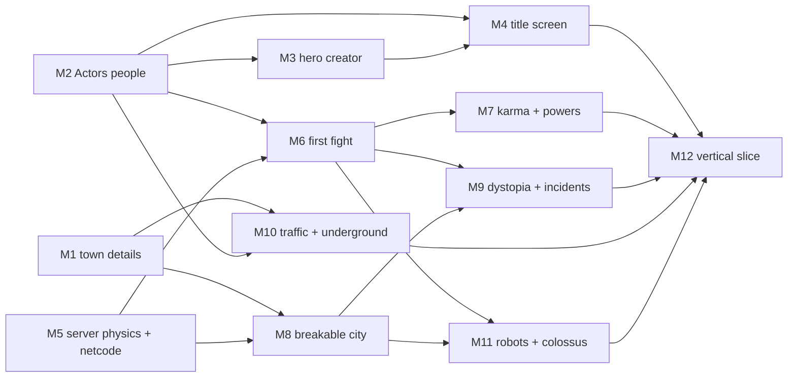

# HeroWorld milestones

As of 2026-11-07, game version 0.008. This plan turns the [design](DESIGN.md) into milestones
up to the vertical slice (one city, two-player co-op) and sketches what comes after. Each
milestone ends in something you can play or look at, gets its own version bumps and "What's
new" lines, and says which other milestones can run at the same time.

## Where we are

**Done (0.001 to 0.006):**

- Workspace `hw-core`, `hw-gen`, `hw-sim`, `hw-net`, `hw-client`; checks, Windows CI, version
  and "What's new" in the game.
- Town generator: towns of any size grow from an old core along roads, rivers and coasts,
  with hills, walls, swallowed villages and quarters in many styles; buildings on every
  street front; pitched roofs and regional traditions; golden-age retro-future in newer quarters.
- The town in 3D on Engine's world streaming: ground and sea to the horizon, buildings on
  slopes and plinths, bridges, water.
- Street furniture (0.006): lamps in each quarter's style, golden-age parked cars, trees by
  region, fountains, benches, hydrants, traffic lights.
- A hero you play in third person: walking, jumping, flying (V), the Aether lift inside
  buildings, buildings cut open at your floor. The hero is still a placeholder shape.
- Server and client: a 30 Hz `bevy_ecs` server inside the game, `hw-headless`, UDP with full
  snapshots, up to 10 players, client prediction for your own hero.

**In progress:** shared procedural textures, taxi pads, neon and steps down to
the water ("Build HeroWorld's foundation" thread).

**Not started:** Actors characters, Engine physics on the server, network deltas and reliable
channels, combat, powers, destruction, incidents, traffic, the underground, robots, saves,
host migration, the planet.

**What Engine already gives us** (all of [ENGINE_REQUESTS.md](ENGINE_REQUESTS.md) is in Engine
`main`, plus more since): headless `PhysicsWorld`, fixed tick with interpolation, breakable
buildings (`engine::building`), ragdolls, rooms and openings for interiors, reflections,
decals, colour grading and fog volumes, instanced crowds, several moons, navigation
(`build_nav`, walking agents), world streaming, GPU particles and destruction effects, 3D
audio with reverb and automatic effect sounds, egui UI. We use only streaming and rendering
so far, so most milestones below are about using what is there.

**What Actors already gives us** (Rust port in `Actors/rust`): `actors-core`,
`actors-human`, `actors-generator` (the same `CharacterConfig` JSON as the web creator,
seeded random characters, outfits, themes, allow rules) and `actors-engine`
(`CharacterBuilder`: a config becomes an Engine `AnimatedModel` with body, skin, hair, clothes
and baked clips). Humans are done; animals, robots and the creator's screens are not ported.

## The milestones

| # | Milestone | Lane | Needs | Can run alongside |
| --- | --- | --- | --- | --- |
| M1 | A town worth walking through | World | (in progress) | M2, M5, assets |
| M2 | People: the hero and the crowd are Actors | Characters | (built, needs a play test) | M1, M5 |
| M3 | Hero creator and hero file | Characters | M2 | M5, M6, M8 |
| M4 | Title screen | Front end | M2 (hero on it), title music | M5, M6, M8 |
| M5 | The server on Engine physics, real netcode | Server | (built, needs a play test) | M1, M2 |
| M6 | First fight | Combat | M2, M5 (physics part) | M3, M8 |
| M7 | Karma, levels and powers | Combat | M6 | M8, M9 |
| M8 | A breakable city | World + Server | M1, M5 | M6, M7 |
| M9 | The dystopia and incidents | Gameplay | M6, M8 | M7, M10 |
| M10 | Traffic, taxis and the underground | World | M1, M2 (crowds, nav) | M7, M9 |
| M11 | Robots and the colossus | Combat + assets | M6, M8 | M9, M10 |
| M12 | Vertical slice: co-op night | all | everything above | — |

### M1. A town worth walking through (in progress)

The street-level look that every later screenshot depends on.

- More street props where they are still missing (kiosks, hero statues, signs), with
  AssetGenerator specs in `assets/specs` for anything that needs a hand-made shape.
- Shared procedural textures for facades, paving and roofs; neon and Aether conduits at night.
- Taxi pads on roofs and platforms, steps and stairs down to the water.
- Interiors in the new town's buildings (rooms, doors, Aether lifts), as the old city had them,
  registered as Engine rooms and openings so they cost nothing from the street.
- Engine reflections (chrome and glass) and reflection probes per district.
- The first city's districts and landmarks: civic centre with the Aether Spire, waterfront
  with a lighthouse; the spot for the dystopian district reserved.

**Done when:** a street, a waterfront and an interior screenshot each look like the 1939
World's Fair city of the design, and the frame rate holds in the downtown of a 40,000-person town.

### M2. People: the hero and the crowd are Actors

Characters come from Actors from here on. This is the first half of the Actors integration.

- `hw-client` depends on `actors-engine` (git, pinned like Engine). The packs come from an
  Actors release (`actors-packs-<version>.tar.gz`), downloaded into a git-ignored folder by a
  script that `start.bat` and CI also run; never committed.
- The hero is an Actors character: idle, walk, run, jump, fall, land, fly and hover clips
  with Engine's blending and foot IK, driven by the movement state the server already sends.
  Other players' heroes the same, from their configs.
- Citizens: `hw-sim` makes each citizen a pure function of (town seed, citizen id, time):
  home, work, route, look (`random_config` with a golden-age theme and allow rules). Only
  citizens near a player are simulated; the client shows them with Engine crowds (the
  Actors "Crowd" level as the far model), the nearest as full characters.
- Engine navigation (`build_nav`) on streets, plazas and building floors, built per cell.
- Ragdolls: a test key knocks people down; they tumble and get up (Engine `knock_down`).

**Done when:** a busy street at noon shows a few hundred citizens walking their routes at a
steady frame rate, and the hero walks, runs and flies with real animation; two players see
each other animated.

**Status (0.018):** built. Heroes are Actors characters with idle, walk, jog, sprint, jump,
fall, landing, and fly and hover clips posed in the game (`hw-client/src/poses.rs`, the packs
have none), tipped and banked in flight; citizens walk the pavements as a pure function of
(town seed, id, time) in `hw-sim/src/citizens.rs`, drawn as Engine crowds in 24 golden-age
looks; K knocks people over and they get up. Still open: Engine navigation (`build_nav`) for
plazas and building floors (citizens keep to street pavements for now), home and work in the
citizens' routes, and the hero's look comes from the player number until M3's hero file.

**Actors work this needs** (in the Actors repo, can run in parallel): a golden-age outfit
theme (suits, hats, dresses, uniforms of the era), an allow preset for HeroWorld (humans, adult,
era clothes), and the "Crowd" LOD export available from Rust.

### M3. Hero creator and hero file

The second half of the Actors integration: the creator's screens, ported to the game.

- A creator screen in egui on `actors-generator`, modelled on the web creator: Simple and
  Detailed tabs per section (body, face, hair, outfit, colours), a random button, a live
  preview with an idle and a heroic pose, and the HeroWorld allow preset.
- The hero file on the player's PC: name, origin, looks (`CharacterConfig` JSON), level,
  karma, affinity, powers. Versioned, so later fields don't break old heroes.
- Joining a game sends your hero file to the host (protocol bump); the host builds your
  hero from it, and everyone sees your looks.
- Costume parts that heroes need and Actors lacks today (capes, masks, gloves, boots,
  tights, chest emblems) go into the Actors repo as garments; the full costume creator
  (emblem editor, materials, capes that move) comes after the slice.

**Done when:** a new player makes a hero in under two minutes, quits, restarts, and finds the
same hero; a friend who joins sees it.

**Status (0.038):** built on Actors' Rust generator (`actors-generator`, pinned at 64c2ed6,
which also brings Engine's animated faces). New hero opens the creator (`hw-client/src/creator.rs`):
Body, Face & hair, Costume and Colours, each with a Simple tab (presets: gender, age, build,
height, heritage, hair, beard, eyes, outfit, colour swatches) and a Detailed tab (every body and
shape slider, skin, stubble, brows, eye colour, the raw face and body sliders, single garments,
free colours); Roll the dice, an at-ease and a heroic pose, the hero turning on a gold pedestal
beside the card, rebuilt on the people worker as you change them (only the newest look waits).
Six golden-age hero costumes made of what Actors has (`people::COSTUMES`: circus strongman,
mystery man, sky ace, rocket ranger, jungle queen, silver-screen sleuth), offered with the
era's clothes (`people::hero_catalog`). The looks (`CharacterConfig` JSON) live in the profile
next to the hero file; a hero from before the creator keeps the clothes the game gave them by
name. Joining sends them in pieces over the reliable channel (`ToServer::Look`,
`ToClient::Look`, `hw_net::look`, protocol 18); the host passes them on and late joiners hear
everyone's; every client builds them through the hero rules (`looks::hero_rules`: hero catalog,
adults, never undressed). The title shows your hero in the heroic pose; a click opens the creator
for their looks. Still open: costume parts Actors lacks (capes, masks, chest emblems), which
belong in the Actors repo.

### M4. Title screen

**Status (2026-11-08, 0.016):** built. The town at golden hour from a camera circling the
Aether Spire, flying taxis, two moons; the HEROWORLD logo (gold letters with a red block
shadow on an arch, swooping in, a glint every 7.5 s, sunburst and Aether sparks, still with
"less motion"); Play/Continue, New hero, Play with friends (host, join by code), Settings,
What's new, Quit; the Lyria title theme fading in and out after the game starts; the town
built behind the title with a loading bar; a camera swoop down to the hero. Profile in
`%APPDATA%\HeroWorld\profile.json`. Still open: searchlights. (0.038: your hero poses in the
foreground on a gold pedestal and a click opens the creator; New hero opens the creator.)

The first thing anyone sees, so it gets hero quality: playful and inviting, at least as good as
Scale's start screen (rising title letters, the sunset city behind, the title theme).

- A live backdrop, not a picture: the game's own city at golden hour from a slow camera
  drifting past the Aether Spire, flying taxis crossing, searchlights, the moons rising. It is
  rendered by the real client, so it gets better whenever the city does.
- The HEROWORLD title as a golden-age comic logo: chrome and sunburst letters that swoop in
  with a whoosh, a glint running across them now and then, Aether sparks around it. Stands
  still with reduced motion.
- Your hero on the screen: the last hero you played strikes a heroic pose in the foreground
  (an Actors character with a pose clip), cape and hair in the wind; a click on them opens
  the creator.
- Few, big, friendly buttons: Continue (your hero, your world), New hero, Play with friends
  (host or join by code), Settings, What's new, Quit. Small print: version and credits.
- Title music (a heroic golden-age theme made with OpenRouter, as Scale's was) with a soft
  fade-in, playing on through loading; playful sounds on hover and click.
- Loading the world behind the title, so Continue starts at once when the city is ready, with
  a progress bar in the same style.

**Done when:** a first-time player smiles at it and knows where to click; it holds 60 fps on
the target PC and appears within a few seconds of launch.

### M5. The server on Engine physics, real netcode

**Status (2026-11-08, 0.014):** built. Change-only updates per client with acks, interest
(500 m plus the player's bubble), a reliable channel (joins, chat, session end), bubbles
that merge and split, Engine `PhysicsWorld` for loose bodies (crates) with building colliders
streamed in, world save, clean session end, GameHub rooms and relay (join by six-letter code).
Ten bots for ten minutes: about 6.4 KB/s per client (budget 25 KB/s). Still open: the hour-long
play test on one machine and over the internet, and Engine's fixed tick and interpolation on the
client (the client still interpolates on its own).

The base for everything that fights, breaks or travels. Pure server and network work, so it
runs alongside the visual milestones.

- `hw-sim` moves its collision to Engine's headless `PhysicsWorld`, with colliders built from
  the same building and ground plans as the client; Engine's fixed tick and interpolation on
  the client.
- Deltas from `bevy_ecs` change detection instead of full snapshots; reliable and unreliable
  channels; interest management (each client gets what is near it).
- Bubbles: one simulated area per player or group, merging when players meet, each with a
  budget.
- The host's world save (damage, incidents later) and a clean session end.

**Done when:** two clients on one machine and two over a real network play for an hour; a
headless test runs 10 bots for 10 minutes; bandwidth per client stays below a set budget.

### M6. First fight

City of Heroes-style combat at its smallest: one hero against the mad scientist's minions.

- Health and energy, Tab targeting nearest the crosshair, con colours, a target frame.
- Two attacks: strike (free, weak) and energy bolt, with hit-stop, camera shake, Engine
  particles, decals and sounds.
- Enemies as Actors characters with their own looks (mutant brute, ray-gun technician): melee
  rusher and ranged, AI on Engine navigation, groups of 3 to 8.
- Knockback into ragdolls and back up; nobody dies: defeated enemies are cuffed and lifted
  away by a police drone; a defeated hero is flown to hospital, or revived by a teammate.

**Done when:** a group of five minions is fun to beat alone and with a friend, and a test
fight runs headless with the same result every time.

**Status (0.024):** built. Server side in `hw-sim/src/combat.rs` (fighters, powers, brute and
technician AI, knockback, cuffs, police and medical drones, revive, respawning groups that grow
with the team); `tests/first_fight.rs` plays it headless (alone and in pairs, same result every
run). Client in `hw-client/src/fightview.rs`. Not yet: AI walks straight at its foe with
collision instead of on Engine navigation (needs nav meshes per cell, see M10), sounds are
synthesized placeholders, and hospitals are the spawn street until the town has them.

### M7. Karma, levels and powers

The progression from the design: karma, levels 1 to 5, affinities, tiers.

- Lifetime karma sets the level, unspent karma buys powers; prices by tier, owned powers and
  affinity; give up a power for 90%.
- Affinities grow from deeds. Origins at hero creation give the first push.
- Powers as mechanic plus theme; the power budget per tier and level; a headless balance run
  that fights every power against standard targets and flags outliers.
- The slice powers: super jump, flight (now an unlock), energy bolt, shockwave, binding hold,
  force shield, lift and carry, each in two themes.
- Level syncing in co-op; the level-up moment.

**Done when:** a new hero reaches level 5 in about an hour of play, the balance run is green,
and two friends of different levels fight together at one level.

**Status (0.027):** built. Rules in `hw-sim/src/progress.rs` (levels: 960 karma for level 2, each
level 25% more; tier 1 costs 960, each tier ×1.5, each owned power +25%; affinity discount up to
30%; origins give 600 affinity; refunds 90%). The hero file (`hw_net::Sheet`) lives in the
player's profile, is sent on joining, and the server checks every buy. Powers in
`hw-sim/src/combat.rs`; themes change name, colour and sound. Team level = the host's; all heroes
fight at it and groups spawn at it. `cargo run -p hw-sim --example balance` fights every power
against standard groups at level 8 over six seeds and flags outliers (green; tests/powers.rs
runs it too). Pacing test: a new hero reaches level 5 after about 62 minutes of play. Villains
walk round walls with a small grid A* over the server's obstacles (`hw-sim/src/nav.rs`), not
Engine navigation, because the server may only use Engine's headless physics. Not yet: the client
crashes out of memory after the first seconds under the headless software renderer (lavapipe),
seemingly from the 17,000 street props (not M7), so in-fight screenshots are pending.

### M8. A breakable city

**Status (2026-11-08, 0.021):** buildings break. Every building becomes Engine's breakable
plan when it is first hit (`hw-sim/src/destruction.rs`): a wall panel per bay and floor (split
round doors, lintels over them), slab and roof tiles, inner walls in pieces, columns where a hall
needs them; strength from material and height. Heroes punch (left mouse) and blast (Q); power
grows 18% a level (`HW_LEVEL` until M7): level 1 breaks glass, plaster and brick, concrete takes
about level 6. The server keeps the broken bits, Engine derives falls, pancake/topple collapses
and rubble; damage goes to clients as reliable deltas (late joiners get it all), collision
follows (walk through the hole, stand on the rubble), saves keep it, and a building nobody has
been within 300 m (plus four times its height) of for 10 minutes is repaired. Clients swap a
damaged building out of its town cell for an Engine breakable building that carries the
town's own facade, cut up by element, so it looks the same until it breaks; sparks, dust,
explosions and scorch/impact decals at every hit. A collateral tally per player waits for
incidents (M9).

**0.023:** street props break too (`hw-sim/src/props.rs`): lamps, traffic lights, trees, pillars
and statues fall over the way they were hit, cars land on their roofs, benches, bins, shrubs and
kiosks are crushed; each kind has a strength (a statue needs about level 6). A blast stops at
the first prop in its way. Broken props go to clients and saves like building damage and are
put back off camera; clients move the instance in the kind's LOD set, and broken lamps go dark
at night. Still open: props that bend rather than snap, and loose debris you can kick; frost
and crack decals from powers (M7); the frame rate during a big tower's collapse on the target
PC.

- `hw-gen` building plans become Engine `BuildingPlan`s: wall panels per bay and floor, slabs,
  columns, roof pieces, interior walls, each with its material strength.
- The server owns the element bits and collapses (pancake and topple), sends them as deltas and
  keeps them in the damage store; clients draw debris, dust and sparks.
- Props, cars and trees bend, topple and break; scorch marks, cracks and frost as decals.
- Off-camera self-repair after about 10 minutes unseen and 300 m away; collateral tally per incident.

**Done when:** a hero can break a facade, bring down a small building and see it whole again
later; a late joiner sees the same damage; the frame rate holds during a collapse.

### M9. The dystopia and incidents (in progress)

Turns the town into a place where problems come to you.

- The mad scientist's district: colour grading and fog volumes, dead conduits and broken
  neon, his Tesla tower and lab, a transition band at its edge; a higher level band.
- Incidents from templates with the spawn rules in the design: muggings, car crashes, fires
  with people inside, robberies, mutant rampages, lab breakouts. Ambient groups on the
  dystopia's corners and rooftops.
- Dispatch: the wrist radio list, map and compass markers, the Hero Signal.
- Rescues: carry the injured to a medic, get people out of burning and damaged buildings.

**Done when:** an hour in the city never runs out of things to do, and each incident type
resolves in single player and co-op.

**Status (0.031):** the district is built. Every town of 3000 people or more has one villain
quarter (`hw-gen/src/urban/dystopia.rs`): grown from a piece of town out from the core along
shared main roads, as large as the town's dystopia share, its edge running along side streets
where no main road bounds it; its blocks are tenements and labs. The Tesla tower stands in
its middle (an iron lattice, a dark dome with green coils and frozen arcs, a blockhouse lab,
a wire fence and dead conduits), sparking green. In the client (`dystopiaview.rs`) the air
turns green-grey and thick and the colour drains as the camera goes in (one fog volume whose
strength follows `Dystopia::depth`, fading above 130 m), two street lamps in three are dead
and the rest flicker green, and shop neon is broken. Ambient corners (`hw-sim/src/quarter.rs`):
groups two levels above the team on its street corners, three at the tower's gate, standing
there only while a hero is within 220 m and going home (to come back fresh) once nobody is
within 420 m. Not yet: rooftop groups, a transition band with graffiti and barricades.

**Status (0.032):** incidents and the wrist radio. `hw-sim/src/incidents.rs` starts muggings
(two brutes), robberies at shop fronts (four, +1 level), mutant rampages (three brutes, +2) and
lab breakouts at the mad scientist's labs (five technicians, +2) 150 to 800 m from a hero:
two to four open at once (one more per extra hero), a minute apart, the first 20 s in, each
chosen from the world seed and a running count. Beating the group resolves it (karma for every
hero within 120 m: the group's worth again, up to 2.5 times for a breakout); one nobody comes
within 60 m of in four minutes ends and its villains leave, as does one the heroes walk away
from. Clients hear of each through `ToClient::Incident` (protocol 15; joiners get the open ones).
The client's wrist radio (`radioview.rs`, top left) lists the calls with distance, a clock
direction and con colour, and a beam of light stands over each. `HW_INCIDENT=1` starts the first
at once; `HW_VIEW=incident` flies the camera to it.

**Status (0.033):** rescues. Two more incident kinds, a car crash with two people trapped and
a house on fire with three inside (`IncidentKind::CarCrash`, `Fire`): no villains, the people
stand where `incidents::victims` puts them (the same on every machine), and a hero holding E
(the revive key) within 3.5 m of the next one gets them out in 4 s (crash) or 3 s (fire),
Guardian karma for each to every hero near. The client shows two smashed, smoking cars, or
flames at the door and windows with smoke over the roof, and the people waving; "Hold E to
help them out" when you are close. `ToClient::Incident` now carries the facing and how many
are left (protocol 16). `HW_INCIDENT=fire|crash|mugging|...` picks the first kind. Not yet:
carrying the injured to a medic, getting people out of buildings that heroes broke, the Hero
Signal, map markers, rooftop groups, the transition band.

**Status (0.034):** the Hero Signal, a compass and a town map (`hw-client/src/dispatchview.rs`).
A mutant rampage or a breakout lights the Signal: a searchlight beam from the Aether Spire's
crown to a glowing disc 260 m over the trouble, a dark star on it, visible from anywhere in
town. A compass strip at the top of the screen marks each call (con colour, distance). M opens
a map of the built-up town: streets, the villains' quarter outlined, landmarks, calls, and
you as an arrow. `HW_VIEW=signal` looks up at the emblem, `HW_VIEW=map` opens the map.

**Status (0.036):** carrying the injured to a medic. A rescue's last person out is hurt: the
hero who freed them holds them (`incidents::Hurt::Carried`), and an ambulance waits at the
kerb of a street about 50 m off (`Incident::medic`). Carried within 5 m of it, they are handed
over (double Guardian karma) and only then is the rescue resolved. A carrier knocked down drops
them (`Hurt::Lying`); any hero lifts them again by holding E for a second. `ToClient::Casualty`
tells clients (protocol 17); they draw a retro ambulance with fins and a bubble light, its
medic, the hurt person lying or across the hero's arms, a red cross on the compass and "Carry
them to the ambulance, N m". `HW_CARRY=1` (with `HW_INCIDENT=fire|crash`) starts with the hurt
one in your arms; `HW_VIEW=medic` looks at the ambulance. Not yet: carrying slows you or
blocks powers; people in buildings that heroes broke.

**Status (0.037):** rooftop lookouts. Flat roofs of two to six floors in the quarter, 80 m
apart and away from the corners (`quarter::lookouts`), each hold three technicians a metre
behind the front parapet (`quarter::perch` finds it from the solids), two levels above the
team, while a hero is within 220 m. A perched villain (`Enemy::perch`) holds its place and
never walks off the edge, notices heroes in the street below without a clear line, steps to
the edge to see them, and reaches 1.6 times as far; one knocked off stays down.
`HW_VIEW=rooftop` looks at the first one.

**Status (0.041):** the quarter's frayed edge (`hw-gen/src/urban/edge.rs`,
`hw-client/src/edgeview.rs`). Walls in the 70 m band around the quarter (and in it) carry
graffiti: four images made with OpenRouter (`assets/graffiti/`, prompts in its README), drawn
as Engine decals, the 60 nearest the camera at a time. Where a street runs into the quarter,
concrete barriers and striped sawhorses reach in from both kerbs and leave one lane open, with
sandbags on the pavements and a burning oil drum. In the band one street lamp in five is out
and one in three flickers. `WORLD_VERSION` 17. `HW_VIEW=edge` and `HW_VIEW=graffiti` look at
them.

**Status (0.042):** barricades are solid and breakable. Each piece is a street prop
(`PropKind::Barricade`: jersey barrier, striped sawhorse, sandbags, burning drum, placed by
`props::barricade_props`), so it breaks and is put back unseen like the rest; while it stands its
box (`BarricadePiece::block`) is in the solids, which drop it when it breaks
(`Obstacles::set_prop_broken`, on the server and on every client). Breaking the villains'
barricades costs no collateral. `WORLD_VERSION` 18.

### M10. Traffic, taxis and the underground (in progress)

- Ground traffic on the streets (AssetGenerator cars with spinning wheels and opening doors as
  Engine prefabs); cars dent, spark and die.
- Flying taxis in lanes at set heights, stands on roofs and platforms; the hero can hail one.
- One underground layer beyond the sewers: utility tunnels plus either mole-people caverns or
  a pneumatic tube line with stations, entered from the streets.

**Done when:** the streets and the sky are busy at noon, a taxi ride crosses the city, and
there is somewhere to go below.

**Status (0.030):** cars drive closed lane loops through the street network (keep right,
rounded corners, wheels turning), hover cars and taxis fly three sky layers over the main
roads; every vehicle's place is a function of seed and time, so all players see the same
traffic. G opens "TAXI! Where to?": a server-driven taxi comes down at the hero, flies the
fare above the roofs to one of up to nine stands (town centre, landmarks, harbour, old
villages, rooftop pads) and lets them out; G again hops out mid-air. Below: utility tunnels
under the main roads, Aether lifts in Googie pavilions on the pavements, and Molehaven, the
mole people's cavern (a great hall, side chambers, a ramp to the tunnels, its own lift),
carved from Engine's voxel ground and walkable on the server. Moving cars can be wrecked: a hero's
blow stops one dented, smoking and askew, its lane jams behind it until the wreck is towed
away unseen. Street cars are a shared simulation (every machine
steps it alike, late joiners are sent it): they follow the car ahead, junctions have two-phase
lights with give-way inside a phase, nobody enters a junction they cannot leave, and a car
stuck a minute turns off the road and comes back where there is room. Still to do: opening
doors, people in Molehaven.

**Status (0.047):** the traffic-light props show their junction's cycle: each light finds its
junction (`Traffic::light_of`) and the phase of the cars it faces, and shows red, amber (the
last 3 s of green) or green (`Traffic::signal`), the same cycle the cars obey. The light's model
(`propmesh::traffic_light`) has dark lenses; `hw-client/src/signalview.rs` draws the lit one
over them from three instanced sets. Broken lights go dark. `HW_VIEW=signals` looks at one.

**Status (0.049):** Molehaven has its people: stallkeepers and shoppers at the market, mole folk
walking from their doors to the market and back, strollers round the well, neighbours chatting
in the side chambers. They are citizens like the street's (a pure function of seed and time,
`hw-sim/src/citizens.rs`, looks `LOOKS..LOOKS + MOLE_LOOKS`, built by `people::mole_person`),
and keep clear of the furniture laid out by `hw_gen::urban::underground::molehaven_layout`.
`HW_VIEW=market` looks at them. Left: opening doors.

### M11. Robots and the colossus

- Non-human robots from AssetGenerator rigs with breakable parts as Engine prefabs, plus
  procedural gaits: the robo-sentry (lieutenant) and the Doctor's walking tank (colossus).
- Lieutenants and bosses with tricks: shield projector, mutant alpha's leap.
- The colossus attack as a set piece: weak points, phases, best with friends; the Hero Signal
  calls everyone.

**Done when:** the walking tank fight is the best ten minutes of the slice.

**Status (0.040):** built, needs a play test with friends. Robot parts are AssetGenerator
`prop.assembly` specs (`assets/robots/specs`, made by `tools/robots/make_specs.py`, built into
`.glb` by `tools/robots/build.py`), put together in Engine as pivots with procedural gaits
(`hw-client/src/robotview.rs`); broken parts come off and shatter. Server in
`hw-sim/src/robots.rs`: weak points are their own fighters riding a part (four knees, the
cannon, the sentry's shield dish). The colossus walks, shells, stomps and discharges; two knees
down and it kneels with the core open; it rises enraged after 25 s; kneels for good when all
four are down; drops robo-sentries; health scales with the number of heroes. The alpha leaps
(windup, landing blow). `hw-sim/tests/colossus.rs` plays the fight with bot heroes: it goes down,
up, down for good, in 2 to 11 minutes, the same every time. Try it: `HW_INCIDENT=colossus`
(`HW_VIEW=colossus` for the camera, `HW_COLOSSUS_BREAK=2` to kneel it). Open: its feet sprawl
about 20 m, wider than many streets, so its legs go through walls; its own music and sounds
(the klaxon, thuds and servos are synthesized for now).

### M12. Vertical slice: co-op night

Everything above, made to hold together for two friends on a weekend evening.

- GameHub lobby with room codes, automatic port mapping (UPnP), host migration.
- Settings, quality presets, controls screen; a Windows build with the packs and assets baked in.
- A soak test with bots, a crash reporter, and the first players' notes turned into fixes.

**Done when:** Arnd and a friend play a whole evening from level 1 without a restart.

## Sound, music and pictures

OpenRouter is available for images, sound effects and music (Arnd's model preferences are in
the `openrouter` skill). No text to speech: characters don't speak aloud; speech is text
(speech bubbles, the wrist radio).

- **Music:** the title theme (M4), then moods for the utopia by day and night, the dystopia,
  fights, the colossus (M11). Each piece loops cleanly and follows the music volume.
- **Sound effects** on top of Engine's built-in ones (explosions, crumbling, water, wind):
  power sounds per theme (M7), hits and hit-stop (M6), UI clicks and whooshes (M4), the
  wrist radio and Hero Signal (M9), taxis and cars (M10), robot servos and the walking tank (M11).
- **Pictures:** concept art to agree a look before building it (the logo, the dystopia, the
  Doctor's tower), power and origin icons, loading-screen art, emblem pieces for costumes.
- Generated files go into `assets/` with a note of the prompt and model, so a sound can be
  made again or changed later; large files are fetched like the packs, not committed, if
  they outgrow the repo.

## After the slice

- **The planet:** cube-sphere terrain with quadtree LOD in Engine (request it then), the
  planet and region layers in `hw-gen` placing cities where rivers meet coasts, roads between
  them, travel speed rising with height, many cities with their own looks.
- **More of everything:** levels to 20 and tiers 4 to 7, more factions (mole people, sky
  pirates, the iron-masked empire), NPC heroes at Hero Hall, more underground layers.
- **The full costume creator** on Actors: emblems, materials, capes; non-human races if wanted.
- **Mac and iPad:** gamepad and touch input, low presets.

## Working in parallel

The milestones fall into lanes that touch different code, so several threads can work at once.
Each lane mostly owns its own crates and modules:

| Lane | Owns | Milestones |
| --- | --- | --- |
| World | `hw-gen`, `townmesh`/`buildingmesh` in `hw-client`, `assets/specs` | M1, M8 (plans), M10 |
| Characters | a new `characters` module in `hw-client`, citizens in `hw-sim` | M2, M3 |
| Front end | a `menu` module in `hw-client`: title screen, settings, lobby screens | M4, M12 (lobby) |
| Server | `hw-sim` core, `hw-net` | M5, M8 (server side) |
| Combat | `combat`, `powers` modules in `hw-sim`, its HUD in `hw-client` | M6, M7, M11 |
| Assets (outside HeroWorld) | AssetGenerator specs for props, cars, taxis, robots | feeds M1, M10, M11 |
| Actors (outside HeroWorld) | era outfits, HeroWorld allow preset, costume garments, Crowd LOD in Rust | feeds M2, M3 |
| Engine (outside HeroWorld) | new requests as they come up, later the planet terrain | as needed |

**Suggested waves:**

1. **Now:** M1 (the running thread), M2 and M5. Assets and Actors work alongside.
2. **Next:** M3, M4, M6 and M8, once M2 and M5 land.
3. **Then:** M7, M9, M10 and M11.
4. **Last:** M12.

Rules for running threads side by side:

- At most three or four HeroWorld threads at once: they all push to `main`, and every push
  bumps `VERSION`, so more than that turns into a queue of rebases.
- Pull and rebase right before each push; if a rebase brings in someone else's version bump,
  take the next number.
- `main.rs` and `session.rs` in `hw-client` are shared: keep changes there small and move new
  work into the lane's own module.
- Protocol and `WORLD_VERSION` bumps are announced in the commit message, so other threads
  notice them on rebase.
